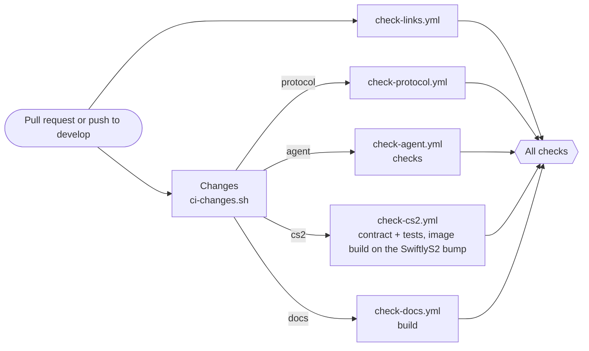
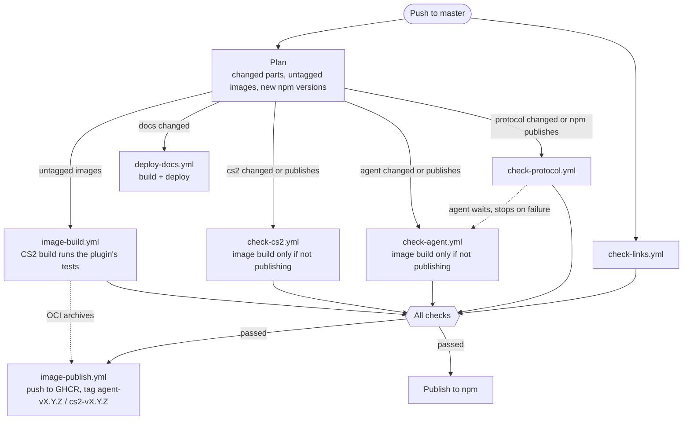
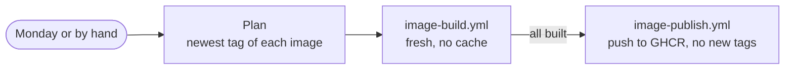
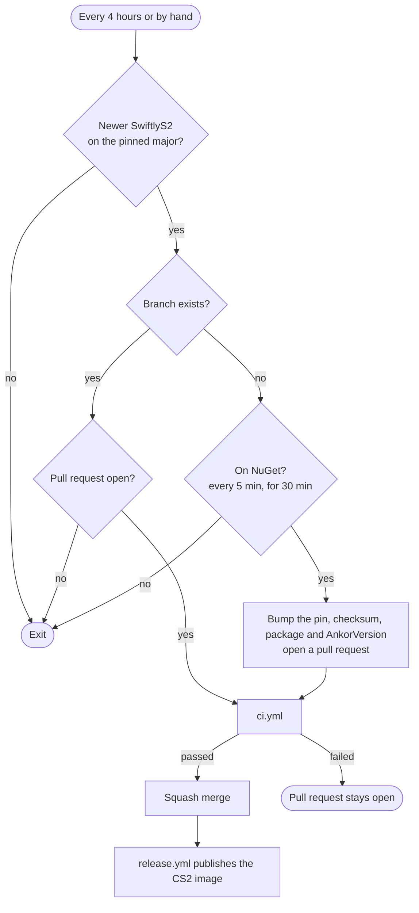
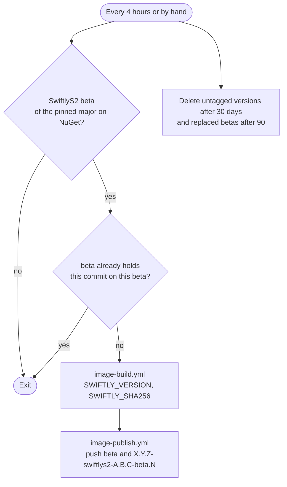

# Workflows

Five workflows start runs. Pull requests and pushes to `develop` run [ci.yml](ci.yml), pushes to
`master` run [release.yml](release.yml), and [rebuild.yml](rebuild.yml) refreshes released images
every week. [swiftlys2.yml](swiftlys2.yml) opens a pull request when SwiftlyS2 has a newer release,
and [cs2-beta.yml](cs2-beta.yml) builds the CS2 image on SwiftlyS2's newest beta. Every other
workflow is reusable, and these five call it.

| Workflow                                 | Called by                                    | Runs                                                                                                                         |
|------------------------------------------|----------------------------------------------|------------------------------------------------------------------------------------------------------------------------------|
| [check-links.yml](check-links.yml)       | `ci.yml`, `release.yml`                      | The check of every relative link and anchor in the Markdown files.                                                           |
| [check-protocol.yml](check-protocol.yml) | `ci.yml`, `release.yml`                      | The build, typecheck, lint and tests of `@ankorcs/protocol`.                                                                 |
| [check-agent.yml](check-agent.yml)       | `ci.yml`, `release.yml`                      | The Rust agent's checks, its contract sync check and, with `image`, an image build.                                          |
| [check-cs2.yml](check-cs2.yml)           | `ci.yml`, `release.yml`                      | The plugin's contract check, a build of its headless host and the plugin's tests, in a CS2 image build with `image`.          |
| [check-docs.yml](check-docs.yml)         | `ci.yml`, `deploy-docs.yml`                  | The docs site build and, with `pages`, the upload of the site as a Pages artifact.                                           |
| [deploy-docs.yml](deploy-docs.yml)       | `release.yml`, by hand                       | The docs site build through `check-docs.yml` and its deployment to Pages.                                                    |
| [image-build.yml](image-build.yml)       | `release.yml`, `rebuild.yml`, `cs2-beta.yml` | The image builds, each kept as an OCI archive artifact of the run.                                                           |
| [image-publish.yml](image-publish.yml)   | `release.yml`, `rebuild.yml`, `cs2-beta.yml` | The push of those archives to `ghcr.io/ankorcs` and, with `tag`, the git tags.                                               |

[ci-changes.sh](../../scripts/ci-changes.sh) decides which parts a change touches, for `ci.yml` and
`release.yml`. It holds the one list of the paths that each part reads.

## Pull requests

`ci.yml` runs the link check on every pull request and every push to `develop`, and the checks of
each part that the change touches. It builds no images, so `check-cs2.yml` runs the plugin's tests
directly. `release.yml` builds the images when a pull request merges into `master`, and publishes
nothing unless they build. The exception is the CS2 image on the SwiftlyS2 bump's pull request
(branch `swiftlys2/…`), because `swiftlys2.yml` merges that pull request by itself once its checks
pass. **All checks** passes when every check passed or had nothing to check, so it is the one check
to wait for.

## Pushes to master

`release.yml` runs the checks of each part that the push changed, and of each package that it is
about to publish. Beside the checks, it builds each image whose version has no git tag yet. The
CS2 build runs the plugin's tests, so `check-cs2.yml` skips its own image build when the image is about
to publish, and so does `check-agent.yml`.

Nothing publishes until **All checks** passes. A failed or cancelled check or build stops every
release of the run, to GHCR and to npm. The docs site deploys once its build passes, independently
of the release.

## Weekly rebuilds

`rebuild.yml` runs every Monday and when run by hand. It rebuilds the newest release of each image from
its tag, on freshly pulled base images, and pushes it under the same tags. Older releases keep
their last build, as [Images](../../docs/requirements.md#images) explains. It runs no checks, because it builds released tags. Every image build must pass before any image is pushed.
`rebuild.yml` and `release.yml` share a concurrency group, so they never push at the same time.

## SwiftlyS2 bumps

`swiftlys2.yml` runs every four hours as the `ankor-sh-bot` GitHub App. A push made with
`GITHUB_TOKEN` starts no workflows, so the App's push is what lets `ci.yml` and `release.yml` run.
[Development](../../DEVELOPMENT.md#release-node-images) lists the App's permissions and secrets.

When a run finds the bump's pull request already open, it merges the pull request once its checks
pass. A bump whose checks finish after the opening run ends therefore merges on the next run. While
the checks fail, each run fails too, until someone fixes or closes the pull request.

## SwiftlyS2 betas

`cs2-beta.yml` runs every four hours and when run by hand. It builds the CS2 image from `master` on
SwiftlyS2's newest beta of the pinned major. It pushes the image as `ankor-cs2:beta` and as
`X.Y.Z-swiftlys2-A.B.C-beta.N`, which names the image version and the SwiftlyS2 beta, such as
`0.6.1-swiftlys2-1.5.3-beta.4`. Nothing is committed for a beta: the workflow passes its version and
checksum to the image build as `SWIFTLY_VERSION` and `SWIFTLY_SHA256`.

- A run builds nothing when `beta` already holds the same commit on the same beta, which the
  image's `org.opencontainers.image.revision` and `ankor.swiftlys2.version` labels record.
- Run by hand, it takes a `ref`. When a beta breaks the plugin, push a fix to a branch and build
  the beta on it before the fix reaches `master`.
- Each run deletes old versions of `ankor-cs2`. GHCR records no time a tag left a version, so a
  version's age is the time it was pushed.
  - An untagged version goes after 30 days, unless a tagged image index lists it, as the image and
    attestation of each release before 0.6.0 are.
  - A beta build goes after 90 days once `beta` has moved on, because its only tags are
    `X.Y.Z-swiftlys2-…` tags.

