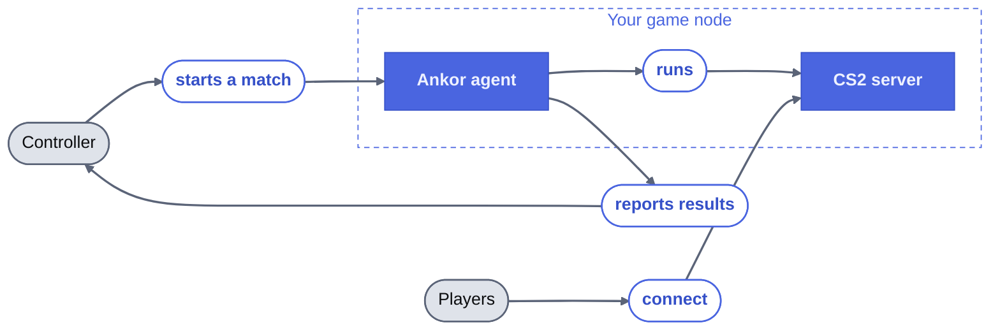

  <a href="https://ankor.sh">
    <picture>
      <source media="(prefers-color-scheme: dark)" srcset="brand/ankor-wordmark.svg">
      
    </picture>
  </a>

<h3 align="center">Game nodes for Counter-Strike 2</h3>

<!-- Community and support -->

  
  

<!-- Code quality -->

  

<!-- Releases -->

  
  
  

Ankor runs Counter-Strike 2 servers on your own Linux hosts. You install the Ankor
agent on a machine and connect it to a controller, and the machine becomes a **game node**. The
agent installs CS2, keeps it up to date and starts a dedicated server whenever the controller asks
for one.

Each game server runs in a fresh container from the official
[Ankor CS2 image](packages/plugin/docker). The image carries the [match plugin](packages/plugin) and
the server configuration, and each server shares one CS2 installation.

The controller decides who plays, on which map and on which node, and keeps the results. Use
[ankor.sh](https://ankor.sh), or build a service of your own on the open protocol.

## Documentation

The node documentation is at [docs.ankor.sh](https://docs.ankor.sh):

- [Quick start](https://docs.ankor.sh/quickstart/): from a Linux host to a lobby on [ankor.sh](https://ankor.sh).
- [Install a node](https://docs.ankor.sh/install/) and [operate it](https://docs.ankor.sh/operations/).
- [The protocol](https://docs.ankor.sh/protocol/), for building a controller of your own.

## Versions

The protocol, the agent image and the CS2 image each have their own version. The protocol's
version decides which of them work together with a controller:

- Between compatible protocol versions, a newer agent or plugin works with an older controller, and
  the other way round.
- A feature works once both sides are on the protocol minor that added it.

[Versioning](https://docs.ankor.sh/protocol/versioning/) lists the releases that support each protocol
version, and what a controller must accept from a newer agent.

## This repository

It holds the open parts of Ankor: the agent, the match plugin and CS2 image, and the protocol
between a controller and its nodes, published as `@ankorcs/protocol` with a session to run it
from a Node.js controller. [ankor.sh](https://ankor.sh) is not part of it.

| Part                                                     | License                                                    |
|----------------------------------------------------------|------------------------------------------------------------|
| `packages/protocol`, and everything without its own file | [Apache-2.0](LICENSE)                                      |
| `packages/agent`                                         | [GPL-3.0](packages/agent/LICENSE)                          |
| `packages/plugin`                                        | [GPL-3.0](packages/plugin/LICENSE)                         |
| `docs`                                                   | [All rights reserved](docs/LICENSE), open to contributions |
| `brand`                                                  | [All rights reserved](brand/LICENSE), shipped with Ankor   |

[Development](DEVELOPMENT.md) describes how to work on it. [Roadmap](ROADMAP.md) lists the planned
work, and [Decisions](ADR.md) the designs that were turned down.
